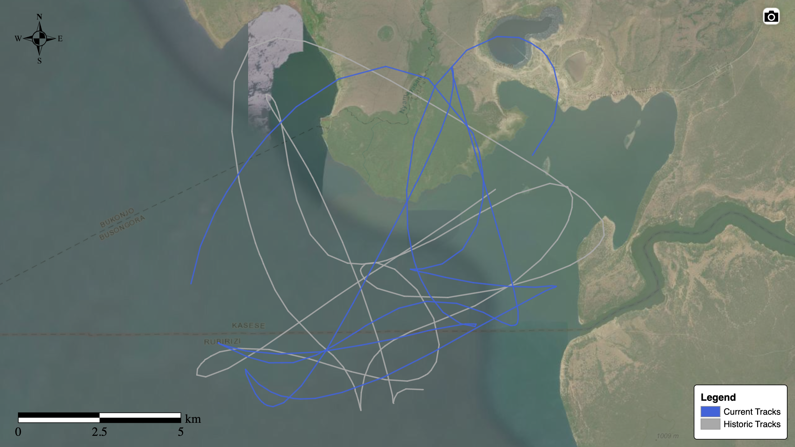

# subject-historic-current-comparison

Maps each subject in an EarthRanger subject group with its tracks from the chosen time range on top of its tracks from a historic period just before it. Current tracks are always drawn on top of historic tracks. By default they're in the subject's EarthRanger colour and the historic tracks are grey; both colours can be changed on the form. By default all subjects share one map; group by subject name to get one map per subject.



*One lion's map from a run against the Sample EarthRanger (made-up data), grouped by subject name: the current two weeks in the subject's colour over the two weeks before in grey.*

## What it does

| Step | What it does |
|---|---|
| **Set Workflow Details** | Add information that will help to differentiate this workflow from another. |
| **Set Groupers** | Shows all subjects on one map by default, or one map per subject when **Group by** has a Subject Name entry. |
| **Connect to EarthRanger** | The EarthRanger site to read from. |
| **Set Time Range** | Choose the period of time to analyze. |
| **Trajectory Segment Filter** | Build a TrajectorySegmentFilter with the project's default thresholds. |
| **Subject Group** | The subject group to map. |
| **BaseMap URLs** | Tile layers drawn under the tracks. |
| **Current Subject Group Observations** | Get observations for a subject group from EarthRanger. |
| **Comparison Period** | The earlier period whose tracks are drawn as comparison tracks. It ends where the current time range starts and, by default, is the same length. |
| **Process Current Relocations** | Cleans the current period's fixes and drops known bad coordinates. |
| **Previous Subject Group Observations** | Get observations for a subject group from EarthRanger. |
| **Current Relocations to Trajectories** | Joins the current fixes into track segments, using the Trajectory Segment Filter settings. |
| **Process Previous Relocations** | Cleans the previous period's fixes and drops known bad coordinates. |
| **Persist Previous Relocations** | Persist dataframe to a file or cloud storage object. |
| **Persist Current Relocations** | Persist dataframe to a file or cloud storage object. |
| **Map Columns** | Maps and transforms the columns of a DataFrame based on the provided parameters. The order of the operations is as follows: drop columns, retain/reorder columns, and rename columns. |
| **Previous Relocations to Trajectories** | Joins the previous fixes into track segments, using the same Trajectory Segment Filter settings as the current tracks. |
| **Persist Current Trajectories** | Persist dataframe to a file or cloud storage object. |
| **Current Duration Status** | Create a new column in the DataFrame with a default value if it doesn't already exist. |
| **Map Columns** | Maps and transforms the columns of a DataFrame based on the provided parameters. The order of the operations is as follows: drop columns, retain/reorder columns, and rename columns. |
| **Persist Previous Trajectories** | Persist dataframe to a file or cloud storage object. |
| **Previous Duration Status** | Create a new column in the DataFrame with a default value if it doesn't already exist. |
| **Concatenate Current and Previous Dataframes** | Merge multiple dataframes into a single dataframe. |
| **Add Temporal Index** | Indexes the tracks by segment start time. |
| **Split Groups** | One table of tracks per map: all subjects together, or one per subject. |
| **Track Colors** | Colours the tracks: historic tracks in the Historic Tracks Color; current tracks in each subject's EarthRanger colour, or in the Current Tracks Color if that's turned off. |
| **Track Order** | Orders the rows so current tracks are always drawn on top of historic tracks. Not on the form. |
| **Subset Columns** | Return a DataFrame restricted to a subset of columns. |
| **Create Path Layer** | Creates a polyline layer definition based on the provided configuration. |
| **Compute View State From Gdf** | Zooms each map to its subject's tracks. |
| **Groupbykey** | Pairs each subject's path layer with its view state. |
| **Draw Current Previous Map** | Creates a map based on the provided layer definitions and configuration. |
| **Persist map as HTML** | Persist text to a file or cloud storage object. |
| **Create Map Widget Single View** | Create a map widget with a single view. |
| **Merge Widget Views** | Combines the per-subject maps into one Movement Tracks widget, so the subject filter switches between them. |
| **Gather Dashboard** | Collects the map widgets into the dashboard. |

## Requirements

- Access to a **EarthRanger** data source, set up as a connection

---

## 1. Load the Workflow

In the workflow runner, add a new template using this repository's URL. Once added, select
**subject-historic-current-comparison** from the available templates list to load it.

---

## 2. Configure the Workflow

You'll be prompted to fill in the following parameters before running.

### Set Workflow Details

| Field | Description | Default |
|---|---|---|
| Workflow Name *(required)* |  | — |
| Workflow Description |  | — |

### Set Groupers

| Field | Description | Default |
|---|---|---|
| Group by | Add a **Category → Subject Name** entry to split the dashboard into one map per subject. Leave it empty to show all subjects on a single map. Subject Name is the only grouping offered. | empty (all subjects on one map) |

### Connect to EarthRanger

| Field | Description | Default |
|---|---|---|
| Data source *(required)* | Select one of your configured data sources. | — |

### Set Time Range

| Field | Description | Default |
|---|---|---|
| Since *(required)* | The start of the current period. | — |
| Until *(required)* | The end of the current period. | — |
| Timezone |  | — |

### Trajectory Segment Filter

Applies to both the current and the historic tracks.

| Field | Description | Default |
|---|---|---|
| Min Length Meters | Minimum segment length in meters. Advanced. | `0.001` |
| Max Length Meters | Maximum segment length in meters. Advanced. | `5000` |
| Min Time Secs | Minimum segment duration in seconds. Advanced. | `1` |
| Max Time Secs | Maximum segment duration in seconds. Advanced. | `21600` |
| Min Speed Kmhr | Minimum segment speed in km/h. Advanced. | `0.01` |
| Max Speed Kmhr | Maximum segment speed in km/h. Advanced. | `9.0` |

### Subject Group

| Field | Description | Default |
|---|---|---|
| Subject Group Name *(required)* | The EarthRanger subject group to map, picked from a drop-down of the subject groups on the data source chosen under **Connect to EarthRanger**. | — |

### BaseMap URLs

| Field | Description | Default |
|---|---|---|
| Base maps | Tile layers to draw under the tracks. The first layer in the list is the bottommost. | Studio's default layers |

### Comparison Period

| Field | Description | Default |
|---|---|---|
| Comparison Period Length *(required)* | How far back the comparison period starts. It always ends where the current time range starts. **Preset**: *Same as current period*, *1 month back*, *3 months back*, *6 months back* or *1 year back*. **Custom**: any number of years, months, weeks, days, hours, minutes and seconds. **Calendar**: an exact start date. | Preset, `Same as current period` |

### Track Colors

Current tracks are always drawn on top of historic tracks where they overlap.

| Field | Description | Default |
|---|---|---|
| Historic Tracks Color *(required)* | Colour of the tracks from the historic period. | `#a9a9a9` (grey) |
| Use subject colors for current tracks | Colour each subject's current tracks with its EarthRanger colour. Untick to use the Current Tracks Color for every subject. | ticked |
| Current Tracks Color | Colour of the current tracks when **Use subject colors for current tracks** is unticked. | `#6495ed` (blue) |

---

## Developing

The run form is set in `spec.yaml`:

- **Set Groupers** is on the form, limited to the default *All* (an empty list) or **Category → Subject
  Name**: `groupers.properties.groupers.items.anyOf` offers a single Category option whose `index_name` is
  `subject_name`. Grouping by subject splits **Split Groups** and every step after it into one map per
  subject; without it there's one map for the whole group.
- `rjsf-overrides` turns the **Subject Group** field (*Var*) into a *Subject Group Name* drop-down: the
  `EarthRangerEnumResolver` transform fills it with the subject groups of the data source picked under
  **Connect to EarthRanger** (`depends_on: properties.er_connection.properties.data_source.properties.name`).
  Inside a task group the override key is `<group title>.properties.<step id>`, so it is
  `Subject Group.properties.subject_group_name.properties.var`.
- `rjsf-overrides` also titles and describes the **Comparison Period** step and defaults its length to the
  *Same as current period* preset: `previous_time_range.properties.offset.default` picks the Preset option,
  and `$defs: PresetPreviousPeriod.properties.preset.default` sets the preset inside it.
- `rjsf-overrides` turns the **Track Colors** fields into two colour pickers (`format: color`) and a
  checkbox, with their titles and defaults. The keys are `status_color_columns.properties.<field>`.
  `previous_color_hex` has no default in the task, so `test-cases.yaml` sets it.
- **Track Order** isn't on the form: `ascending: false` is fixed in the spec. Rows draw in order, so the
  label sorted last ends up on top. *Current Tracks* sorts before *Historic Tracks*, so descending puts the
  current rows last, on top. Don't drop `ascending` from the spec: `sort_values`' own default (`true`)
  would put the historic tracks on top. If either label in the **Current/Previous Duration Status**
  steps changes, check this still holds.
- **Trajectory Segment Filter**, **BaseMap URLs** and **Comparison Period** have no fixed values in the spec,
  so they're on the form for each run.
- Both periods are joined into tracks with the **Trajectory Segment Filter** settings
  (`${{ workflow.segment_filter.return }}`), so they're filtered the same way.

```bash
# recompile spec.yaml (first time: --install; after that: --update, which bumps VERSION.yaml)
./dev/recompile.sh --update
```

### Testing

`test-cases.yaml` has two kinds of case:

| Case | Data | What it covers |
|---|---|---|
| `base` | mock IO | every field at its form default, so one map for all subjects |
| `single-current-color` | mock IO | one picked colour for all current tracks, a non-default historic colour, *3 months back*, grouped by subject name |
| `sample-er` | Sample EarthRanger | Lions over two weeks, with the two weeks before as the historic period, all five on one map |
| `sample-er-no-history` | Sample EarthRanger | a historic period before the Sample EarthRanger's data starts, so only current tracks are drawn; grouped by subject name |

With mock IO the platform's packaged fixture stands in for both observation fetches (it ignores the
time range), so the historic and current tracks are the same. The `sample-er` cases need the local
Sample EarthRanger running on `http://127.0.0.1:8797` (EcoWorkbench → Connections → Sample EarthRanger →
**Start**), with the connection passed as environment variables:

```bash
# mock-IO cases
pixi run --manifest-path pixi.toml -e default bash dev/pytest-cli.sh subject_historic_current_comparison --case base --skip-setup

# Sample EarthRanger cases
env 'ECOSCOPE_WORKFLOWS__CONNECTIONS__EARTHRANGER__SAMPLE EARTHRANGER__SERVER=http://127.0.0.1:8797' \
    'ECOSCOPE_WORKFLOWS__CONNECTIONS__EARTHRANGER__SAMPLE EARTHRANGER__USERNAME=demo' \
    'ECOSCOPE_WORKFLOWS__CONNECTIONS__EARTHRANGER__SAMPLE EARTHRANGER__PASSWORD=demo' \
    pixi run --manifest-path pixi.toml -e default bash dev/pytest-cli.sh subject_historic_current_comparison --case sample-er --skip-setup
```

Results land in `/tmp/workflow-test-results/subject_historic_current_comparison/<case>/`. The thumbnail
(`resources/thumbnail.png`) is one lion's map from a `sample-er` run grouped by subject name (the
Sample EarthRanger's lions are at two sites far apart, so the all-subjects map is too zoomed out to read).

Documentation: [docs/index.html](docs/index.html).
