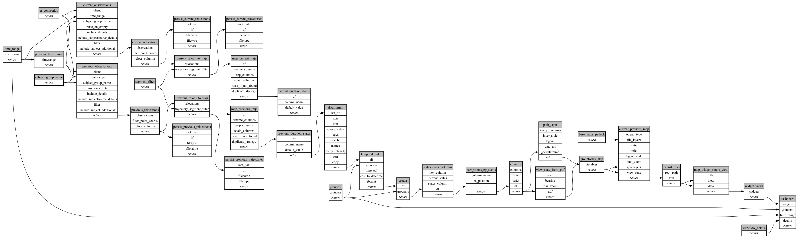

```
# AUTOGENERATED BY ECOSCOPE-WORKFLOWS; see fingerprint in README.md for details

```

```yaml
# fingerprint:
artifacts_sha256_basic: fa5998cb74d2e00bdb4fdeb84c37aeb506ce434e20d3fefb6e64640ee645144a
artifacts_sha256_strict: 5d3f924dd1e55199990a7a6911ef3fe31510aa9b9136626525cbe84024d5ea7d
installed_requirements:
- channel: https://repo.prefix.dev/ecoscope-workflows/
  name: ecoscope-platform
  version: {version: ==2.25.3}
- channel: https://repo.prefix.dev/ecoscope-workflows-custom/
  name: ecoscope-workflows-ext-custom
  version: {version: ==0.1.4}
- channel: https://repo.prefix.dev/ecoscope-workflows-custom/
  name: ecoscope-workflows-ext-ste
  version: {version: ==0.0.24}
- channel: conda-forge
  name: pydeck
  version: {version: ==0.9.2}
params_sha256: 1c606499752c3923b59d11be899dee3b027d9742ce4df5a6ff9dda4eb99210c8
spec_sha256: fc911b75bbf1530c41bce7b7c23d324325b1a1809445a19fcf84699de725ede8

```

# ecoscope-workflows-subject-historic-current-comparison-workflow


