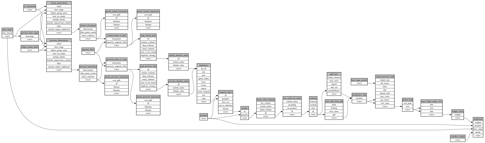

```
# AUTOGENERATED BY ECOSCOPE-WORKFLOWS; see fingerprint in README.md for details

```

```yaml
# fingerprint:
artifacts_sha256_basic: 4bc135a1a7586eda9dabada1cd7e909cadd86067f0f31b5b328d7e2ac5c81f1f
artifacts_sha256_strict: e48e7a201d39c64d2748dbccf15e9b522a745ca366eb57cd5edd1bf999ce3c0a
installed_requirements:
- channel: https://repo.prefix.dev/ecoscope-workflows/
  name: ecoscope-platform
  version: {version: ==2.25.3}
- channel: https://repo.prefix.dev/ecoscope-workflows-custom/
  name: ecoscope-workflows-ext-custom
  version: {version: ==0.1.4}
- channel: https://repo.prefix.dev/ecoscope-workflows-custom/
  name: ecoscope-workflows-ext-ste
  version: {version: ==0.0.24}
- channel: conda-forge
  name: pydeck
  version: {version: ==0.9.2}
params_sha256: a2308518060a378f5eaf7e56a6000e37f3a2d531a937b711b6a1667440145495
spec_sha256: 28dd72cc851c5dc5ea449536de62c4c412adab1f7c1ac6030d845e978c4df142

```

# ecoscope-workflows-subject-historic-current-comparison-workflow


